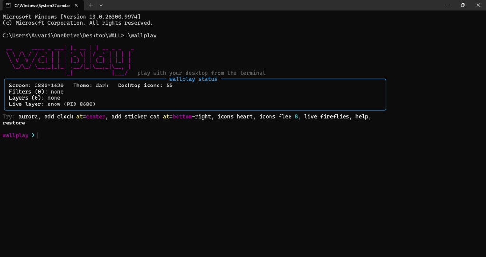
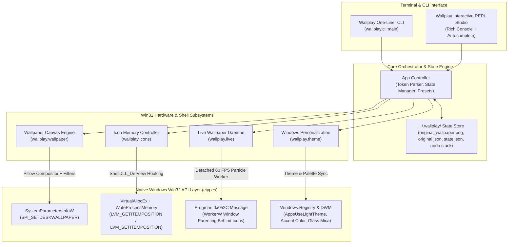

<div align="center">

# 🌌 WALLPLAY
### *Play with your Windows desktop from the terminal*

A powerful, lightweight, non-destructive CLI & REPL studio to style, animate, and control your Windows desktop. Procedural wallpapers, 20+ stackable visual filters, dynamic on-screen widgets, physics-driven desktop icons, and 60 FPS live interactive wallpapers running *behind* your desktop icons.

---

[](https://www.microsoft.com/windows)
[](https://www.python.org/)
[](https://python-pillow.org/)
[](https://github.com/Textualize/rich)
[](https://learn.microsoft.com/en-us/windows/win32/)
[](LICENSE)
[](#-safety--restoration-guarantee)

<br/>

[Overview](#-overview) • [Live Terminal Preview](#-live-terminal-preview) • [System Architecture](#-system-architecture) • [Key Highlights](#-key-highlights) • [Installation & Quickstart](#-installation--quickstart) • [Feature Deep Dive](#-feature-deep-dive) • [CLI Command Reference](#-cli-command-reference) • [Safety & Restoration](#-safety--restoration-guarantee) • [Project Structure](#-project-structure) • [Connect & Author](#-connect--author)

---

</div>

<br/>

## 📖 Overview

**Wallplay** is an all-in-one terminal studio for Windows that elevates your desktop into an interactive, customizable canvas. Powered by native Win32 system APIs via Python ctypes and accelerated by Pillow, Wallplay eliminates bloated, resource-heavy desktop customization suites.

Whether you want to generate smooth procedural aurora wallpapers, stack cyberpunk glitch and neon filters, drop dynamic desktop sticky notes and live clocks, arrange desktop icons into mathematical shapes (hearts, spirals, waves), animate icons with real-time mouse-flee physics, or spawn ambient live particle effects running behind your icons — Wallplay does it all from a lightning-fast terminal prompt.

> [!IMPORTANT]
> **100% Non-Destructive Guarantee**: On its very first run, Wallplay silently snapshots your original desktop wallpaper and exact (X, Y) pixel positions of every single desktop icon. Running `wallplay restore` puts everything back precisely the way it was.

---

## 🖥️ Live Terminal Preview

Wallplay provides an interactive REPL shell equipped with real-time hardware and desktop telemetry, auto-command hints, and instant visual execution:

<div align="center">
  
  <p><em>Interactive Wallplay Studio showing resolution detection (2880×1620), Windows Dark theme sync, 55 tracked desktop icons, and active background live layer (snow PID 8680).</em></p>
</div>

---

## 🏗️ System Architecture

Wallplay interacts directly with the Windows Desktop Shell using low-level Win32 APIs, memory injection into `explorer.exe`'s `SysListView32` icon container, and `WorkerW` HWND parenting for true live wallpaper rendering beneath icons:



---

## ✨ Key Highlights

- **Procedural Bases & Shaders**: Generate smooth multi-stop gradients, procedural auroras with custom noise seeds, solid color fills, or load custom images.
- **20+ Stackable Visual Filters**: Chain filters non-destructively: `tint`, `hue`, `duotone`, `neon`, `glitch`, `dream`, `cartoon`, `sketch`, `pixelate`, `vignette`, and `surprise`.
- **Dynamic On-Screen Widgets**: Pin live clocks (12/24h), dynamic calendars, sticky notes with paper tape and tilt angles, live system telemetry (CPU, RAM), quotes, and countdown timers.
- **Desktop Icon Geometry**: Instantly arrange messy desktop icons into mathematical formations: circle, heart, spiral, sine wave, star, infinity, smile, grid, and diagonal.
- **Mouse-Interactive Icon Physics**: Make your desktop icons come alive! Watch them flee from your cursor, get sucked into a magnetic attractor, orbit, dance, or fall under gravity.
- **Live Interactive Wallpaper**: Spawns detached 60 FPS particle engines (`snow`, `fireflies`, `matrix`, `bubbles`, `starfield`, `fireworks`, `rain`) or interactive desktop pets that wander behind your desktop icons.
- **Windows System Integration**: Sync Windows Dark/Light mode, enable taskbar glass transparency, and automatically extract accent colors directly from the wallpaper palette.
- **Safety First**: Full state snapshots, persistent undo/redo history, and a zero-fuss one-line `restore` command.

---

## 🚀 Installation & Quickstart

### Prerequisites
- **Operating System**: Windows 10 or Windows 11 (64-bit)
- **Python**: Version 3.9 or higher

### 1. Clone & Navigate
```powershell
git clone https://github.com/harinarayana1457-cmyk/Wallplay.git
cd Wallplay
```

### 2. Set Up Virtual Environment & Dependencies
```powershell
python -m venv .venv
.\.venv\Scripts\Activate.ps1
pip install -r requirements.txt
pip install -e .
```

### 3. Launch Wallplay
You can launch the interactive studio or run commands as direct one-liners:

```powershell
# Launch the interactive REPL Studio
wallplay

# Or use the convenient batch launcher
.\wallplay.bat
```

```powershell
# Direct one-line executions from PowerShell / CMD:
wallplay aurora
wallplay add clock at=center
wallplay add note "Ship the feature 🚀" at=top-right angle=-4
wallplay icons heart
wallplay icons flee 8
wallplay live fireflies
wallplay restore
```

---

## 🔍 Feature Deep Dive

### 1. Procedural Wallpaper & Visual Filter Stack
Wallplay treats the desktop as a layered canvas. Start with a base, apply any combination of stackable filters, and watch your screen transform instantly.

```powershell
# Choose a base
wallplay solid hotpink
wallplay gradient "#0f172a" "#3b82f6" "#ec4899" angle=135
wallplay aurora seed=42
wallplay image "C:\path\to\photo.jpg"

# Stack filters non-destructively
wallplay duotone "#1e1e2e" "#cba6f7"
wallplay neon
wallplay glitch 4
wallplay vignette 0.6
wallplay unfilter last
```

### 2. Dynamic On-Screen Widgets & Sticky Notes
Overlay information HUDs, reminders, and decorative elements directly onto your desktop image with coordinate, percentage, or named anchor positioning:

```powershell
# Add sticky notes with tilt and tape
wallplay add note "Review PR #42 & Deploy 🚀" at=top-right color="#fff176" angle=-4

# Live time & date HUD
wallplay add clock at=center format=24 font=mono size=80
wallplay add calendar at=bottom-left color="#ff4f8b"

# Telemetry, quotes, and countdowns
wallplay add sysinfo at=top-left
wallplay add quote at=bottom-right
wallplay add countdown 2026-12-31 "New Year!" at=center

# Inspect and manage active layers
wallplay layers
wallplay remove 1
```

### 3. Desktop Icon Playground & Physics Simulations
By injecting cross-process memory into the Windows Shell (`SHELLDLL_DefView` / `SysListView32`), Wallplay reads and manipulates real desktop icon positions in real time.

```powershell
# Geometric arrangements
wallplay icons heart
wallplay icons spiral
wallplay icons wave
wallplay icons infinity
wallplay icons circle
wallplay icons grid

# Real-time mouse physics animations (duration in seconds)
wallplay icons flee 10       # Icons scatter away from your mouse cursor
wallplay icons follow 8      # Icons trail behind your mouse pointer
wallplay icons magnet 8      # Icons get pulled toward your cursor
wallplay icons dance 6       # Icons groove in sinusoidal rhythm
wallplay icons gravity 8     # Icons bounce under simulated desktop gravity
wallplay icons rain 10       # Icons rain down from the top of the screen

# Icon layout snapshots
wallplay icons save my_setup
wallplay icons load my_setup
wallplay icons restore       # Snap back to original positions
```

### 4. Live Interactive Wallpapers (Behind Icons)
Unlike tools that render a top-level window over your desktop, Wallplay sends an undocumented `0x052C` message to `Progman` to split the Windows desktop and safely hook its rendering window directly onto `WorkerW` — **behind your desktop icons**.

```powershell
# Start 60 FPS ambient live wallpaper daemon
wallplay live fireflies
wallplay live snow
wallplay live matrix
wallplay live starfield
wallplay live fireworks
wallplay live bubbles
wallplay live rain

# Desktop pet wandering behind icons that chases your cursor
wallplay live pet cat
wallplay live pet dog
wallplay live pet dino
wallplay live pet unicorn

# Manage daemon
wallplay live status
wallplay live stop
```

### 5. Windows Personalization & Presets
```powershell
# Dark / Light Mode & Glass Transparency
wallplay theme dark
wallplay theme toggle
wallplay theme glass on
wallplay theme bars on

# Intelligent color matching from wallpaper palette
wallplay accent match
wallplay accent auto
wallplay accent "#38bdf8"

# Save & Load entire setups (wallpaper + filters + widgets + icons)
wallplay preset save cyberpunk
wallplay preset load cyberpunk
wallplay preset list
```

---

## 🛡️ Safety & Restoration Guarantee

Desktop customization tools often mess up desktop icon grids, leaving users frustrated. **Wallplay is designed with a strict safety-first philosophy:**

```
~/.wallplay/
├── original_wallpaper.png     # Byte-for-byte copy of your original desktop image
├── original.json              # Exact X, Y pixel coordinates of every desktop icon
├── state.json                 # Current wallpaper filters, layers, and configuration
├── undo/                      # Multi-level historical rollback snapshots
└── presets/                   # Saved user themes
```

- **Automatic Baseline**: On the very first invocation, Wallplay captures your existing wallpaper and queries `SysListView32` to record the position of every single icon.
- **One-Command Rollback**: Running:
  ```powershell
  wallplay restore
  ```
  instantly terminates any active live wallpapers, restores your original wallpaper image, and teleports every single desktop icon back to its original coordinate.

---

## 📋 CLI Command Reference

### Wallpaper Bases & Filters
| Command | Arguments | Description |
| :--- | :--- | :--- |
| `solid` | `<color \| random>` | Fill background with a solid hex, RGB, or named color |
| `gradient` | `<c1> <c2> [c3] [angle=135]` | Generate a smooth multi-stop linear color gradient |
| `aurora` | `[seed]` | Procedural generative aurora borealis background |
| `image` | `<path>` | Load any image file (`.png`, `.jpg`, `.webp`) as wallpaper base |
| `original` | *None* | Revert back to your baseline wallpaper image |
| `tint` | `<color> [0.0-1.0]` | Apply a color wash overlay |
| `hue` | `<degrees>` | Shift overall color spectrum (-180° to 180°) |
| `duotone` | `<dark_color> <light_color>` | Transform image into a stylish two-tone palette |
| `saturate` / `bright` / `contrast` | `<factor>` | Adjust color saturation, brightness, or contrast multiplier |
| `gray` / `sepia` / `invert` | *None* | Grayscale, vintage sepia tone, or color inversion |
| `blur` / `pixelate` | `[radius / size]` | Gaussian blur or retro pixel-block effect |
| `neon` / `glitch` | `[amount]` | Vibrant edge-glowing neon or digital chromatic aberration |
| `dream` / `cartoon` / `sketch` | *None* | Artistic stylization filters |
| `surprise` | *None* | Rolls a randomized combination of creative filters |
| `unfilter` | `[# \| last \| all]` | Remove active filters from the pipeline |

### Layers & Widgets
| Command | Options | Description |
| :--- | :--- | :--- |
| `add text` | `"Text" [at=...] [color=...] [size=90] [font=bold|mono|script] [angle=0]` | Render custom typographic text layer |
| `add note` | `"Content" [at=top-right] [color=#fff176] [angle=-4]` | Post a realistic pinned sticky note with tape |
| `add clock` | `[at=center] [format=24|12] [size=80]` | Digital desktop clock widget |
| `add calendar` | `[at=bottom-left] [color=...]` | Current month calendar grid widget |
| `add sticker` | `<cat|rocket|fire|✨|...> [at=...] [size=160]` | High-res vector/emoji stickers |
| `add shape` | `<circle|ring|star|heart|triangle|square|moon> [color=...]` | Geometric decorative shapes |
| `add sysinfo` | `[at=top-left] [color=...]` | Live hardware telemetry (CPU, RAM utilization) |
| `add quote` | `["Text"] [author=...]` | Inscribed inspirational quote widget |
| `add countdown` | `YYYY-MM-DD ["Title"] [at=...]` | Days remaining countdown banner |
| `layers` / `remove` | `[# \| last \| all]` | List all placed layers or delete a layer by index |
| `watch` | `[interval_seconds]` | Periodically re-render dynamic widgets (clocks, sysinfo) |

### Desktop Icons & Live Wallpaper
| Command | Arguments | Description |
| :--- | :--- | :--- |
| `icons <shape>` | `circle \| heart \| spiral \| wave \| star \| grid \| infinity \| smile` | Arrange desktop icons into mathematical coordinates |
| `icons <physics>` | `flee \| follow \| magnet \| dance \| orbit \| gravity \| rain [sec]` | Run real-time mouse-interactive icon physics loop |
| `icons list` / `move` | `[name \| #] <x,y \| pos>` | Inspect all icons or move an individual icon |
| `icons save` / `load` | `<name>` | Save or recall an icon layout preset |
| `icons restore` | *None* | Restore desktop icons to their original backed-up layout |
| `live <effect>` | `snow \| fireflies \| bubbles \| matrix \| starfield \| fireworks \| rain` | Launch background 60 FPS live wallpaper behind icons |
| `live pet` | `[cat \| dog \| fox \| duck \| dino \| unicorn \| penguin]` | Spawn an animated pet that roams behind icons and follows mouse |
| `live status` / `stop` | *None* | Check active live wallpaper daemon PID or kill the worker |

### System & Presets
| Command | Arguments | Description |
| :--- | :--- | :--- |
| `theme` | `dark \| light \| toggle \| glass on\|off \| bars on\|off` | Switch Windows theme mode and DWM transparency |
| `accent` | `<color \| match \| auto \| random>` | Change Windows accent color or match from wallpaper |
| `preset save` / `load` | `<name>` | Save or load full desktop theme (wallpaper + filters + widgets + icons) |
| `status` | *None* | Display real-time telemetry card (resolution, theme, icon count, live PID) |
| `undo` | `[all \| step]` | Undo all changes (stickers, widgets, filters, wallpaper & icons), or `undo step` for 1 step |
| `restore` | *None* | Emergency rollback: restores original wallpaper and icon positions |

---

## 📂 Project Structure

```
Wallplay/
├── assets/
│   └── wallplay_terminal.png    # Live REPL terminal interface preview
├── wallplay/
│   ├── __init__.py              # Package entry & version metadata
│   ├── __main__.py              # Python module entrypoint (`python -m wallplay`)
│   ├── cli.py                   # Rich-based interactive REPL & command dispatcher
│   ├── common.py                # State paths, JSON persistence & backup managers
│   ├── icons.py                 # ShellDLL_DefView hook, memory injection & physics engine
│   ├── live.py                  # WorkerW window parenting & 60 FPS particle daemons
│   ├── theme.py                 # Windows registry customization & color extraction
│   ├── wallpaper.py             # Pillow-powered procedural generator, filters & widgets
│   └── winapi.py                # Pure ctypes Win32 API definitions & bindings
├── pyproject.toml               # Modern PEP 621 build configuration
├── requirements.txt             # Production dependencies (pillow, rich)
├── wallplay.bat                 # Windows CMD/PowerShell convenience launcher
├── .gitignore                   # Ignore rules for virtual environments & caches
└── README.md                    # Comprehensive documentation & reference
```

---

## 🔗 Connect & Author

**Harinarayana Avvari**

[](https://www.linkedin.com/in/hari-narayana-035ba1389/)
[](https://github.com/harinarayana1457-cmyk)

---

## 📄 License

This project is licensed under the terms of the [MIT License](LICENSE).
Feel free to use, modify, and distribute it freely.
